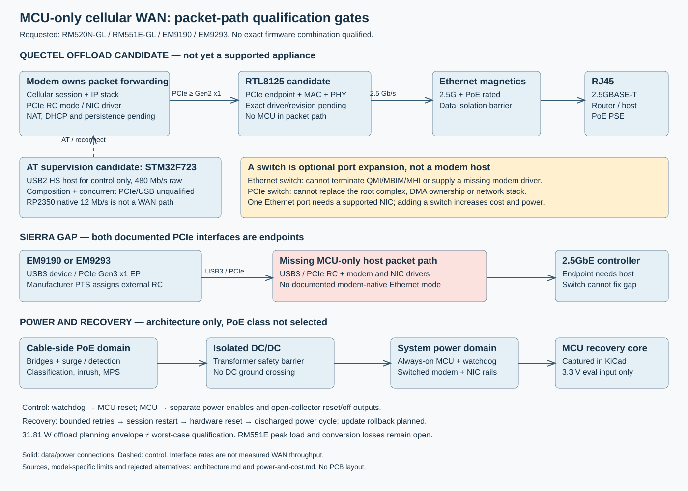
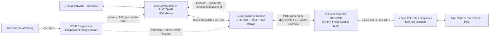
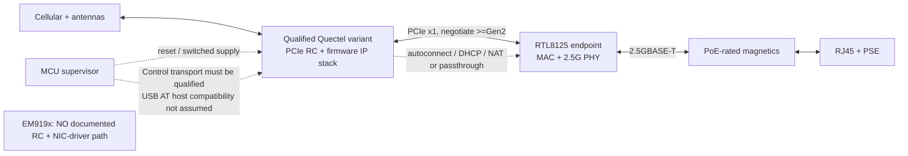
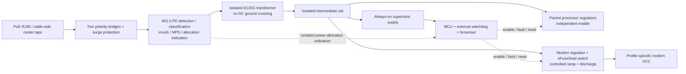

# Packet-path feasibility — 2026-09-28

**Historical MCU-only analysis, superseded for processor selection on
2026-09-29.** The user directed Rockchip Linux qualification, and RK3566 is now
the selected evaluation candidate; see [rockchip-qualification.md](rockchip-qualification.md).
The exact four-modem product qualification remains open. Requested models are
RM520N-GL, RM551E-GL, EM9190, and EM9293.
Neither RP2350 nor STM32N657A0 provides a documented multi-gigabit path for
EM919x. A Linux USB 3 host plus a 2.5GbE controller is the current interface
direction for both vendors. No modem / firmware combination has been tested or
qualified by this project. All four models remain in scope; detailed integration
still requires exact electrical choices and modem evidence.

## Does a switch solve this?

No documented switch-only solution was found for EM9190 or EM9293. An Ethernet switch
forwards Ethernet frames; it cannot terminate the modem's USB composite device,
QMI/MBIM or MHI transport. A PCIe switch forwards transactions but does not add
the missing root complex, DMA-buffer ownership, NIC/modem drivers or routing
software. An integrated switch with an application processor would still need
that processor and its software; renaming it a switch does not satisfy MCU-only.

For a qualified Quectel RC mode, a **PCIe NIC controller**, not a switch, connects
the modem to one Ethernet port. [Realtek's RTL8125BG/BGS description](https://www.realtek.com/Product/Index?cate_id=786&id=3962)
explicitly identifies the MAC, PHY, PCIe controller and memory. A switch could
add a separate MCU management port, but cannot fix Sierra hosting and increases
cost/power. No undocumented internal MAC-to-switch interface is assumed.

STM32F723VET6 is a candidate for **USB2 high-speed AT supervision only**, because
[ST documents its on-chip HS USB PHY](https://www.st.com/resource/en/datasheet/stm32f723ve.pdf).
That would avoid depending on the modem accepting a USB full-speed control host.
It still needs USB-composition, vendor-control-driver and simultaneous PCIe/USB
testing on each exact Quectel firmware. It is not a multi-gigabit packet forwarder.
The G0 schematic milestone is a reset/watchdog subsystem, not proof of this AT path.

## Evidence, roles, and limits

| Candidate | Packet path and ownership | Status |
|---|---|---|
| RP2350A forwarding | Modem USB device → RP2350 USB host → external Ethernet interface | Reject for high throughput: native host is 12 Mb/s; no native PCIe host or Ethernet MAC. External SPI Ethernet does not remove the bottleneck. [RP2350 datasheet §12.7](https://datasheets.raspberrypi.com/rp2350/rp2350-datasheet.pdf) |
| STM32N657A0 forwarding | USB 2 HS host → MCU RAM/software → Ethernet | Reject for >1 Gb/s: 480 Mb/s USB signaling, native Ethernet maximum 1 Gb/s; a 2.5G PHY cannot increase either. [ST product specification](https://www.st.com/en/microcontrollers-microprocessors/stm32n657a0.html) |
| RM500Q-GL offload | Modem **PCIe root complex** → RTL8125 PCIe endpoint containing MAC+PHY → magnetics → cable | Promising low-cost Quectel-only candidate. Hardware Design V1.1 §4.3 documents RC/EP; EVB guide §3.8 names RTL8125, but its worked commands demonstrate RTL8111H. Exact RTL8125 silicon revision, firmware, call setup and recovery remain a gate. |
| RM520N-GL offload | Modem RC → RTL8125 endpoint; modem firmware forwards packets | Hardware guide V1.0 describes role-dependent PCIe controls. Need manufacturer data-call guide and exact approved firmware for Ethernet/NAT/DHCP. Do not infer support for RM520N-EU, RM502Q-AE, RM521F, RM551E, or other RM5x models. |
| RM551E-GL offload | Candidate modem RC → supported PCIe Ethernet controller | Exact production hardware design, NIC-driver support and firmware data-call behavior not established from an accessible manufacturer integration guide. Do not copy RM520 commands or qualify engineering samples from forum anecdotes. |
| EM9190 / EM9191 offload | Would require modem RC and a modem-resident NIC driver/router | **Not established.** Manufacturer PTS r5 §1.3 assigns module EP / host RC. No documented RTL8125-hosting Ethernet mode found. Two endpoints plus wires or a PCIe switch do not supply a host. |
| EM9293 offload | Modem PCIe Gen3 x1 EP → external RC required | **Not established.** EM92XX PTS r1 §1.3 explicitly assigns EP/RC roles; §3.3 requires USB3 support and says USB2 is not commercially supported. No documented modem-resident NIC driver/router found. |
| Common external packet processor | Either modem USB device → USB 3 host → Linux network stack → PCIe 2.5GbE controller | **RK3566 selected for evaluation on 2026-09-29.** See [processor qualification](rockchip-qualification.md); no throughput or modem tuple has passed yet. |

Manufacturer sources:

- [Sierra PTS r5, 41113174, manufacturer-hosted PDF](https://forum.sierrawireless.com/uploads/short-url/3YiSVtuUkMfbRcpmg2rbz4MZxDI.pdf), March 2022. **Older reference**, not a substitute for a revision-difference review. [Current r11 landing page](https://source.sierrawireless.com/resources/airprime/minicard/airprime_em919x-7690_product_technical_specification) is public; its PDF download redirected to login. r5 §3.3 says USB 2 operation is not commercially supported; do not select a USB2-only Sierra host.
- [EM92XX PTS r1, 41114313](https://forum.sierrawireless.com/uploads/short-url/alktoXf2aUKhq8BTQEyAvx4HliS.pdf), October 2023. Manufacturer-hosted older reference; [current r7.2 landing page](https://source.sierrawireless.com/resources/airprime/minicard/airprime_em92xx_product_technical_specification) download is login-gated. Current revision and exact firmware still need review.
- [RM500Q-GL Hardware Design V1.1](https://quectel.com/content/uploads/2024/02/Quectel_RM500Q-GL_Hardware_Design_V1.1-2.pdf).
- [Quectel 5G-M2 EVB User Guide V1.0, §3.8](https://quectel.com/content/uploads/2024/02/Quectel_5G-M2_EVB_User_Guide_V1.0-2.pdf).
- [RM520N-GL Hardware Design V1.0](https://forums.quectel.com/uploads/short-url/1zkjPRnxF5BZ2woox386baCZx4g.pdf), especially §§3.2 and 4.3. Preserve USB2 recovery; never burn interface-selection eFuses as routine configuration. Coexistence signals are not a general AT UART.
- [NXP LS1028A specifications](https://www.nxp.com/products/LS1028A): USB3, PCIe RC and 2.5G Ethernet resources. Shared SerDes lane assignments still require a reference-manual check before capture.

## Data and control diagrams

Solid links carry packets. Dashed links carry control. Rates below are interface
signaling/link rates, **not measured WAN throughput**. USB3 Gen1 is 5 Gb/s raw;
PCIe Gen2 x1 is 5 GT/s (4 Gb/s after 8b/10b, before protocol overhead).

## Product networking contract (proposed)

Default to **routed IPv4 NAT**, one downstream subnet, DHCP server, DNS forwarding
and stateful firewall. Ethernet client obtains a private address even during
cellular outage, with status accessible locally. This avoids pretending raw-IP
QMI/MBIM is an Ethernet bridge. The packet processor owns these services in the
common-host option; modem firmware must explicitly supply them in the offload
option. IPv6 needs a separate carrier PD/RA policy and validation; no blanket claim.

IP passthrough is an optional, separately qualified single-client mode. Define MAC
binding, lease renewal after PDP address changes, gateway/DNS behavior, management
reachability and IPv6 first. A cellular CGNAT address remains CGNAT; passthrough
does not create a public address or an Ethernet PDU service.

Provisioning means factory/user profile contains APN, authentication and PDP type,
plus SIM PIN policy if applicable. Do not assume a provisioned SIM discovers a
private APN automatically. Store a validated profile locally; carrier tables are
defaults, not authority. Never repeatedly try unknown SIM PINs. For unattended
installation, a missing profile or PIN is a visible configuration fault, not a
reset loop. No cloud account is necessary for boot or recovery.

## Exact compatibility gate

| Model candidate | Firmware baseline | Qualification state |
|---|---|---|
| EM9190 | Candidate generic SWIX55C_03.17.09.00 / PRI 030.115_000; exact orderable SKU and carrier mapping required | USB-host architecture supported by docs; firmware binary, release notes, current pinout and bench tests pending. mmWave adds antennas and power. |
| EM9293 | **Unselected**; exact SKU and carrier package required | EP/USB3 host roles established by older manufacturer PTS; current pinout, firmware and bench qualification pending. No MCU-only offload evidence. |
| RM520N-GL | **Unselected**: require manufacturer-approved USB firmware for exact hardware revision | USB interfaces documented; no available hardware/firmware identity or carrier test. Offload firmware remains separate. |
| RM551E-GL | **Unselected**: production versus engineering-sample identity also required | [Quectel brochure V8.5](https://www.quectel.com/content/uploads/2026/01/Quectel_Product_Brochure_V8.5_2026.pdf) lists the product, but is not a pinout, Ethernet driver or recovery specification. |

RM500Q-GL is retained above only as a manufacturer-documented example of the RC
architecture; it is not substituted for either requested Quectel model.

[Sierra's approved firmware table](https://source.sierrawireless.com/resources/airprime/software/em919x/em9-approved-fw-packages)
also lists operator-specific packages. Firmware approval is not appliance
qualification. Record ATI, firmware, PRI, USB VID/PID/composition, module SKU and
hardware revision, carrier, SIM profile, host kernel/driver and image hash for each
tested configuration. No support label until cold boot, reattach and traffic pass.

## Historical requirement alternatives before RK3566 selection

1. Retain both vendors and multi-gigabit target: a packet-processing SoC with USB3
   is an interface-feasible alternative; **the user selected this direction on
   2026-09-29 for RK3566 evaluation**.
2. Retain MCU-only: qualify one Quectel offload combination and explicitly remove
   Sierra support. This does **not** meet the current dual-vendor requirement.
3. Retain low-end MCU forwarding: lower throughput substantially and still obtain
   vendor-supported transport/driver evidence. A 2.5G link sticker is no solution.

FPGA USB3/PCIe host + routing logic is not a low-cost shortcut: host IP, modem
protocols, external memory and update recovery remain required.

## Recovery contract

MCU rail survives independent modem/host power cuts. Hardware defaults keep
downstream power disabled until stable rails, adequate PoE allocation and valid
profile. MCU checks host heartbeat and rail faults; external watchdog resets MCU
independently of the MCU's internal watchdog. Reset outputs must not back-power
an unpowered modem or processor.

Use a bounded state machine: power stable → boot → identify exact modem → unlock
known SIM → configure APN → register → create session → verify IP/route → serve.
On failure, retry the session, then software restart, then hardware reset, then
power cycle with minimum off/discharge time. Use backoff with a capped rate of
destructive recovery. No network coverage is not evidence of a crashed modem.
Require multiple independent health indicators; one unreachable ping host must
not cause continuous resets. After restoration, DHCP/DNS/route state must update.

Signed host A/B images with bounded boot attempts and rollback; protected MCU
bootloader with two independently validated application slots; power-loss-safe
configuration journal. Modem updates use the vendor recovery transport. Do not
promise modem A/B if its firmware does not document it. Keep a maintenance USB
path and a physically accessible MCU SWD recovery header. Firmware is not
implemented in this schematic-only session.

## Evaluation before PCB work

On evaluation hardware, test each exact tuple above: 100 cold boots; cable/PSE
power cycling; no SIM / PIN lock / invalid APN; cellular detach/reattach; host and
modem hangs separately; rail sag during transmit; unplug during each update
phase; recovery without remote service; 24-hour mixed traffic and thermal soak.
Acceptance target is multi-gigabit where RF/network permit (proposed test threshold
at least 2.0 Gb/s downstream; exact simultaneous upstream target still unspecified);
measure local forwarding separately from WAN, both directions and small packets.
Record loss, latency, CPU load, temperatures and power. All tests are **not run**.

## Socket profile hazard — integration must remain gated

The M.2 mechanical key is not proof of electrical interchangeability. EM919x PTS
r5 and EM92XX PTS r1 assign VCC to **2, 4, 24, 38, 68, 70, 72, 74**.
RM520N-GL Hardware Design V1.0 assigns VCC to **2, 4, 70, 72, 74**, while
contact **24 is a 1.8 V output**, 38 is WLAN_TX_EN, and 68 has a non-VCC
assignment. Never connect the Sierra extra supply contacts to a universal VCC
plane. This is a possible damage condition, not a software compatibility issue.
Use physically keyed/profile-specific hardware or a reviewed, default-disconnected
power selection design; software identification after applying unsafe power is
not sufficient. RM551E-GL needs its own manufacturer pin table before capture.

Other profile-dependent contacts include USB VBUS sensing, PCIe disable, reset,
SIM detect and coexistence lines. Manufacturer reference circuits and the current
hardware revision must establish voltage levels, default pulls and sequencing.
The shared USB and SIM pin locations alone do not qualify the full socket.
The full engineering schematic now captures the modem socket, SIM and assembly-selectable profiles. See [schematic-completion.md](schematic-completion.md) for current pin/profile verification and release holds. No profile is qualified for hot interchange.
