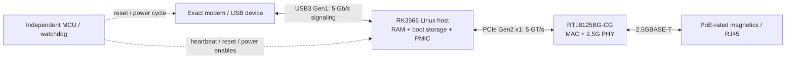

# Rockchip Linux host comparison

2026-09-28 alternatives study, retained for comparison. On 2026-09-29 the user
directed Rockchip Linux processor qualification; **RK3566 is now the selected
evaluation candidate**, as recorded in [rockchip-qualification.md](rockchip-qualification.md).
It is not a production architecture release. All four modem models remain in
scope. Detailed integrated capture still requires exact RAM, PMIC, NIC and modem
interface evidence.

## Recommended custom-board candidate

**RK3566 + RTL8125BG-CG**, with qualified external RAM, boot storage, PMIC and the
independent recovery MCU. No switch or USB hub is required for a single port.

Rockchip's [RK3566 datasheet rev 1.2, p15](https://wiki.friendlyelec.com/wiki/images/8/89/Rockchip_RK3566_Datasheet_V1.2-20220930.pdf)
assigns USB3 host/SATA1 to Multi-PHY1 and PCIe2.1/SATA2 to Multi-PHY2. They are
separate, so USB3 plus PCIe can operate without a shared USB hub. PCIe supports RC
mode and one 5 GT/s lane. The integrated Ethernet MAC is not the 2.5G path.

| Option | Assessment |
|---|---|
| RK3566 + PCIe RTL8125 | Lowest-cost direct USB3/PCIe candidate established in this comparison; quad A55. CPU is 15.5 × 14.4 mm, but RAM, PMIC, storage and supporting parts must also fit. |
| RK3568 / RK3568B2 + RTL8125 | More interfaces and PCIe resources, not a compelling saving for one modem/one port. RK3568 LCSC listing is about $16.61 at 70+, versus RK3566 $9.84 at 102+. Exact B2 revision is a separate BOM choice. |
| RK3562 | USB3 and PCIe share one PHY: cannot use USB3 modem plus PCIe NIC simultaneously. A USB hub/NIC alternative adds hardware, driver/traffic work and shared-bus limits. |
| RK3528 | USB3/PCIe combo lane similarly requires a different topology; not selected merely because the CPU is cheaper. |
| RK3506 | USB2-only; not appropriate for the multi-gig modem path. |
| RK3328 | Older low-cost USB3 platform, but no suitable PCIe NIC path established here; hub-based USB Ethernet needs separate performance qualification. |
| RK3566 SoM | Offloads DDR/BGA/PMIC integration to module vendor; may win total cost at low volumes. Exact module configuration, stock and production quote are not secured. |

Sources: [RK3562 manufacturer datasheet rev 2.0, p12 (mirror)](https://rockchip.fr/RK3562%20datasheet%20V2.0.pdf),
[RK3528 manufacturer datasheet (mirror)](https://rockchip.fr/RK3528%20datasheet%20V1.0.pdf),
[RK3506 manufacturer product page](https://www.rock-chips.com/a/en/products/RK35_Series/2025/1208/2126.html),
[RK3568 manufacturer datasheet](https://opensource.rock-chips.com/images/b/b6/Rockchip_RK3568_Datasheet_V1.3-20220929P.PDF).

## Source-backed cost baseline

USD distributor page snapshots, excluding tax/shipping. Different available price
breaks are stated explicitly; this is not a complete matched/qualified BOM or a
100-unit committed quote. Inventory can change and does not establish lifecycle.

| Part | LCSC | Displayed unit price / break | Displayed stock |
|---|---|---:|---:|
| RK3566 | [C2943786](https://www.lcsc.com/product-detail/C2943786.html) | $9.8432 / 102+ | 713 |
| RTL8125BG-CG | [C3013605](https://www.lcsc.com/product-detail/C3013605.html) | $2.9561 / 100+ | 1416 |
| RK809-5 | [C2939628](https://www.lcsc.com/product-detail/C2939628.html) | $1.5061 / 100+ | 1565 |
| H9HCNNN8KUMLHR-NME, 1 GB LPDDR4 | [C2912103](https://www.lcsc.com/product-detail/C2912103.html) | $25.2348 / 30+ | 81 |
| THGBMTG5D1LBAIL, 4 GB eMMC | [C5197299](https://www.lcsc.com/product-detail/C5197299.html) | $18.1620 / 30+ | 205 |
| **Five-part arithmetic subtotal** | | **$57.70** | RAM stock is below 100 |

The RAM/eMMC rows are available pricing examples, not verified compatible selections.
They demonstrate why a $10 SoC does not establish a $20 complete Linux host. With
supporting regulators/inductors/clocks/decoupling/reset/protection, allocate roughly
**$65–80 of electronic parts for this host/NIC implementation**, before magnetics,
PCB, assembly, modem/SIM circuitry, PoE and independent MCU. This is an estimate,
not a quoted complete design. Do not reuse the earlier generic low memory-cost
allowance as if a matched Rockchip BOM has been sourced.

Potential savings: qualify a smaller DDR configuration, a production-volume memory
source, and SPI flash storage with a minimal OpenWrt image. Flash selection must
preserve recovery and sufficient A/B image space. A cheap single-image flash part
or an unqualified RAM substitution is not a valid unattended-product cost saving.
Neither alternate memory training nor alternate boot storage is qualified here.

A [NanoPi R5C](https://www.friendlyelec.com/index.php?product_id=290&route=product/product)
was listed at $82 and in stock during this comparison. Its [manufacturer wiki](https://wiki.friendlyelec.com/wiki/index.php/NanoPi_R5C)
documents RK3568B2, USB3, dual 2.5GbE and a 58 × 58 mm board, plus published
schematics and current RTL8125 software updates. It is an evaluation option, not
a validated Sierra carrier or a PoE appliance. Exact selected store configuration,
shipping and adapter/power costs must be checked before any purchase.

A [Radxa CM3](https://radxa.com/products/cm/cm3/) is 55 × 40 mm and has the required
USB3/PCIe resources, but no sufficiently firm low-cost production offer was secured
in this comparison. Do not substitute an old launch price for a current quote.

## What makes the custom route manufacturable

Published [NanoPi R3S/LTS schematics](https://wiki.friendlyelec.com/wiki/images/f/fd/NanoPi_R3S_LTS_2411_SCH.pdf)
provide a concrete RK3566/DDR/PMIC/USB3/PCIe integration reference; its RTL8111H
Gigabit circuit is not an RTL8125 drop-in reference. Use an exact RTL8125 reference
circuit, magnetics, silicon revision and reset/clock/power specification.

Budget a controlled-impedance multilayer board and BGA assembly/X-ray capability.
A 6–8-layer allowance is an estimate until escape/DDR/return-path planning proves
the stackup. Dense SoC decoupling will likely need 0402/0201 exceptions to the 0603
signal-passive default; do not promise the smallest footprint while requiring every
passive to be 0603. No layout has been created or historical CAD restored.

Freeze the RAM topology and exact MPN before capture. Rockchip's [DDR firmware
release notes](https://github.com/rockchip-linux/rkbin/blob/master/doc/release/RK3566_EN.md)
show training/boot fixes and memory-support changes; pin an evaluated DDR binary,
U-Boot, kernel and device tree. [U-Boot supports RK3566 platforms](https://docs.u-boot.org/en/stable/board/rockchip/rockchip.html).
This does not automatically qualify a new PCB or modem composition.

Linux owns USB host enumeration, modem session management (qualified MBIM/QMI and
AT), routing/NAT/firewall, DHCP/DNS, and the PCIe NIC driver. The small MCU owns
independent recovery. Vendor modem integration packages and firmware/carrier tuples
still require review. Preserve ROM/USB recovery, SWD, signed A/B updates and bounded
power cycling. CPU/USB/IRQ performance with NAT and real modem traffic must pass a
2.5GbE throughput test; interface rates alone are not throughput proof. Do not
budget line-rate SQM/VPN/security inspection without separate performance tests.

Decision: use RK3566 + RTL8125 as the custom-board evaluation candidate; test modem and
Linux behavior on existing hardware first. At small quantities, compare a firm SoM
quote against the entire assembled custom circuit plus engineering/re-spin cost.
At higher quantities, seek traceable production memory supply before asserting the
custom route is cheapest. No vendor contact, purchase or new CAD integration done.
