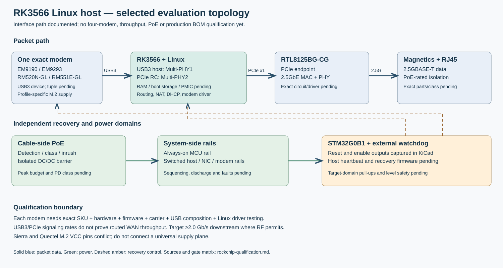

# RK3566 packet processor qualification

2026-09-29. **Decision: RK3566 is the Linux processor candidate for the
four-modem appliance.** This is an interface and sourcing qualification for
evaluation and schematic planning, not a production release or a claim of
multi-gigabit routed throughput.

## What the processor closes

[Rockchip's RK3566 datasheet rev 1.2, connectivity section](https://wiki.friendlyelec.com/wiki/images/8/89/Rockchip_RK3566_Datasheet_V1.2-20220930.pdf)
assigns USB3 host to Multi-PHY1 and PCIe 2.1 to Multi-PHY2. Its PCIe port
supports root-complex mode, one lane and 5.0 Gb/s serial signaling in each
direction. The on-chip Ethernet MAC is limited to 1 Gb/s. Therefore the chosen
packet path is:

`exact modem USB3 device → RK3566 USB3 host / Linux → RK3566 PCIe RC →
RTL8125BG-CG PCIe endpoint + 2.5GbE MAC/PHY → rated magnetics → RJ45`.

[Realtek identifies the RTL8125BG-CG](https://www.realtek.com/Product/Index?cate_id=786&id=3962)
as a PCIe 2.1 Ethernet controller with the MAC, 2.5GBASE-T transceiver and
memory. The RTL8125 replaces neither Linux packet processing nor the modem
driver. USB3 and PCIe link rates are ceilings before protocol overhead; neither
proves 2.0 Gb/s cellular WAN or routed/NAT throughput. No switch or USB hub is
required for this one-modem, one-port topology.

Linux owns modem enumeration and session control, routing/NAT/firewall,
DHCP/DNS, the NIC driver, and update rollback. The captured independent
STM32G0B1 recovery candidate provides fault detection, host/modem power enables
and reset, and must stay powered while either downstream rail is cut. The
appliance MCU choice is not frozen by selecting RK3566. Target reset pull-ups
and level translation must be checked at the actual host and modem pins.

## Exact qualification matrix

| Gate | Evidence now | Release condition |
|---|---|---|
| RK3566 I/O topology | Separate USB3-host and PCIe-RC PHY choices in Rockchip datasheet; [NanoPi R3S LTS schematic](https://wiki.friendlyelec.com/wiki/images/f/fd/NanoPi_R3S_LTS_2411_SCH.pdf) is an RK3566/RK809/LPDDR4 integration reference. | Verify chosen USB3 and PCIe balls, clocks, resets, supplies and pin mux against current Rockchip hardware design guide and complete board reference. |
| RTL8125BG-CG | Realtek documents PCIe and integrated 2.5GbE MAC/PHY. | Obtain exact BG-CG hardware reference/pinout, power/reset, magnetics recommendation and Linux driver/revision test before drawing its circuit. |
| EM9190 | Older Sierra PTS establishes USB3 device operation. | Exact SKU, hardware revision, current PTS, firmware/PRI/carrier tuple, USB composition, Linux MBIM/QMI path and bench traffic. |
| EM9293 | Older Sierra PTS establishes USB3 device operation; USB2 is not commercially supported. | Same exact tuple and current controlled PTS; cold-boot, recovery and traffic results. |
| RM520N-GL | Manufacturer hardware guide describes USB interfaces. | Approved USB firmware for exact hardware, composition, driver and carrier tuple; bench traffic and recovery. |
| RM551E-GL | Product listing only; no reviewed production pinout or USB integration guide. | Production identity, current hardware guide, USB mode/firmware, driver and carrier tuple; bench traffic and recovery. |
| RAM, boot and PMIC | RK809-5 plus LPDDR4/eMMC appears in published RK3566 reference hardware. | Freeze compatible RAM topology/MPN and trained DDR binary; select storage size from signed A/B image and recovery requirements; approve PMIC rail map, sequence and current at worst case. |
| PoE, socket and thermal | Domains and profile conflict already identified. | Recompute peak simultaneous load including RK3566; select PD class and isolation parts; use safe profile-specific modem socket design; thermal/EMC review. |

Each modem tuple is recorded separately as SKU, hardware revision, firmware,
carrier/PRI, SIM/APN profile, USB VID/PID and composition, host kernel/driver,
image hash and measured results. One family's pass is not inherited by another.
The shared M.2 socket remains unsafe as a common VCC plane because Sierra and
Quectel assign contacts 24/38/68 differently; see [architecture.md](architecture.md).

## Candidate BOM and sourcing check

PCBParts/JLC catalog lookup on 2026-09-29. These are catalog snapshots, not
reserved stock, a matched design or a production quote. The RAM and eMMC are
**comparison placeholders** and must not be captured as compatible selections.

| Function | Candidate / package | LCSC | Catalog stock | 100-unit price break where shown | State |
|---|---|---|---:|---:|---|
| Linux packet processor | Rockchip RK3566 / FCCSP565L, 15.5 × 14.4 mm | [C2943786](https://www.lcsc.com/product-detail/microcontrollers-mcu-mpu-soc_rockchip-rk3566_C2943786.html) | 739 | $9.7466 at 102+ | Selected evaluation candidate; pin/power design pending. |
| 2.5GbE controller | Realtek RTL8125BG-CG / QFN-48-EP, 6 × 6 mm | [C3013605](https://www.lcsc.com/product-detail/ethernet-transceivers_realtek-semicon-rtl8125bg-cg_C3013605.html) | 931 | $2.8314 at 100+ | Interface candidate; exact circuit pending. |
| PMIC | Rockchip RK809-5 / QFN-68-EP, 7 × 7 mm | [C2939628](https://www.lcsc.com/product-detail/power-management-specialized_rockchip-rk809-5_C2939628.html) | 1560 | $1.4929 at 100+ | Reference-based candidate; rail map/current pending. |
| 1 GB LPDDR4 example | SK hynix H9HCNNN8KUMLHR-NME / BGA-200 | [C2912103](https://www.lcsc.com/product-detail/ddr-sdram_sk-hynix-h9hcnnn8kumlhr-nme_C2912103.html) | 81 | No 100-unit break shown | Not selected; insufficient listed stock for 100 units. |
| 4 GB eMMC example | Kioxia THGBMTG5D1LBAIL / WFBGA-153 | [C5197299](https://www.lcsc.com/product-detail/memory-controllers_kioxia-thgbmtg5d1lbail_C5197299.html) | 254 | No 100-unit break shown | Not selected; capacity and A/B layout unproven. |

The processor/NIC/PMIC trio is **$14.07 at the shown ~100-unit breaks**,
excluding RAM, storage, regulators, clocks, magnetics, connectors, modem,
PoE, MCU, PCB and assembly. The example RAM/eMMC prices have different breaks;
combining them into a 100-unit product quote would misstate cost. The
[published NanoPi R3S LTS schematic](https://wiki.friendlyelec.com/wiki/images/f/fd/NanoPi_R3S_LTS_2411_SCH.pdf)
supports a practical integration route but uses a different Ethernet circuit.

## Bench acceptance before complete schematic release

1. On evaluation hardware with USB3 and PCIe simultaneously active, confirm
   `lsusb -t` SuperSpeed enumeration, `lspci` RTL8125 enumeration, a 2.5GBASE-T
   link and stable operation across cold boot, restart and power cuts.
2. Run each exact modem tuple through SIM/APN provisioning, attach/reattach,
   IP assignment, routed IPv4 DHCP/DNS/firewall, and vendor recovery/update.
3. Measure local USB3-to-Ethernet forwarding separately from cellular WAN in
   both directions, small packets and long mixed traffic, including CPU, IRQ,
   thermals, rail current and packet loss. The proposed downstream acceptance
   target is at least 2.0 Gb/s where RF/network permit; simultaneous upstream
   target remains to be set.
4. Exercise 100 cold boots, PSE/cable cycles, bad SIM/APN, modem and Linux
   hangs, rail sag and interrupted image updates, using the independent MCU's
   bounded recovery contract.

None of these bench tests has run. Detailed Rockchip/DDR/PMIC/NIC capture should
follow exact reference-circuit and BOM selection; it would otherwise imply
electrical qualification that the evidence does not yet support.
